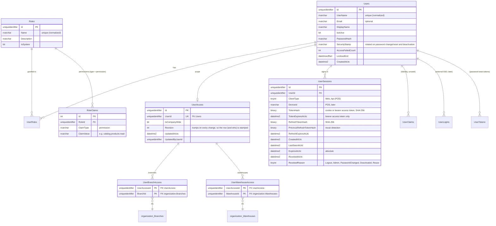
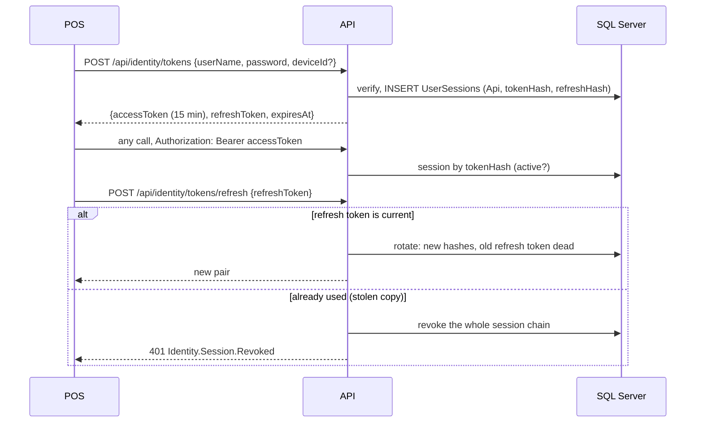

# Identity & Access Management module — design for review

Status: **accepted (2026-10-26) with the five decisions in §12**. Phase: after the architecture refactoring, before
Inventory. Supersedes the "JWT bearer only with a trusted issuer" part of ADR 0005.

Refinements made while planning the implementation:
* Effective access (permissions + warehouses) is **resolved on every request** in the authentication handler, not
  cached across requests: always correct after a change, cheap at this scale; a cache can come later behind the same
  handler.
* Refresh rotation keeps **one row per session**: the previous refresh-token hash is kept to detect reuse, instead of
  a chain of rows.
* Identity use cases change several stores at once (accounts, roles, access, sessions); they share one save point,
  `IIdentityPersistence.SaveChangesAsync`, still exactly one `SaveChanges` (one transaction) per use case. ASP.NET Core
  Identity stores run with `AutoSaveChanges = false` so they don't save on their own.

## 1. Goals and boundaries

* Users, passwords, lockout and roles managed with **ASP.NET Core Identity**, kept inside the module's Infrastructure.
* **Permission-based authorization** with **branch / warehouse scope**.
* Login, logout, user / role / permission / scope management, **session revocation**, real authorization tests.
* A login method for the **React** client and one for the **POS**, leaving room for **offline POS**.
* Same rules as every module: Clean Architecture, Result, FluentValidation, Options, Serilog, architecture tests.
* Other modules keep depending only on `ICurrentUser` and Contracts, never on `ApplicationUser` or Identity stores.
* One new migration, `Migration02_Identity`, that **adds** an `identity` schema and changes no existing table.

Out of scope for this phase: MFA, external SSO (the Identity tables keep the door open), POS device registration and
offline grants (designed in §7, built with the POS module), operational AuditLog table.

## 2. Module layout (same shape as Organization and Catalog, ADR 0001)

| Project | Holds |
|---|---|
| `WarehouseERP.Identity.Domain` | `Role` (name, permissions, system flag), `UserAccess` (company-wide flag, branch and warehouse grants), `UserSession` (lifecycle: issue, touch, rotate, revoke, expire), domain errors. **No ASP.NET Core Identity types.** |
| `WarehouseERP.Identity.Application` | Features (below), ports (ADR 0011: `Abstractions/Interfaces/<Group>/`): `IUserAccounts` (find, create, profile, activate), `IUserCredentials` (verify password, lockout, change/reset password, unlock), `IUserRoleAssignments`, `IRoleRepository`, `IUserAccessRepository`, `ISessionRepository`, `IUserReadStore`, `IIdentityPersistence` (the one save point), validators, `IdentitySessionOptions`. Random tokens and their hashing are the domain's `SessionTokens`. |
| `WarehouseERP.Identity` (outer) | **Infrastructure**: `ApplicationUser : IdentityUser<Guid>`, `ApplicationRole : IdentityRole<Guid>`, `UserManager`/`RoleManager` behind the ports, EF configurations, session authentication handler, `HttpCurrentUser` (moves here from the host), `PermissionAuthorizationHandler`, per-request access resolution, Data Protection key store. **Presentation**: `/api/identity/*` endpoints. |
| `WarehouseERP.Identity.Contracts` | `IdentityPermissions`, `IUserDirectory` (user id → display name, for "created by" in other modules). |

`PermissionDefinition` (name, module) moves to `BuildingBlocks.Application.Security`; each module
registers its own definitions in `Add<Module>Module()`. Identity validates role permissions against that catalog and
the host builds one policy per definition, so no module (Identity included) references another to learn permissions.

Architecture tests change in two places: Identity's outer project may configure its own Infrastructure entity types
(`ApplicationUser`, `ApplicationRole`) besides Domain ones, and no assembly other than `WarehouseERP.Identity` and
`Persistence` may reference `Microsoft.AspNetCore.Identity.*` / `Microsoft.Extensions.Identity.*`.

### One DbContext
`ErpDbContext` derives from `IdentityDbContext<ApplicationUser, ApplicationRole, Guid, …>` so the Identity mapping stays
Microsoft's, and renames its tables into the `identity` schema. It remains one context and one transaction (CLAUDE.md:
one `ErpDbContext` in V1). Other modules still receive `DbContext` and never see `IdentityDbContext`.
*Alternative considered*: a separate `IdentityDbContext` — rejected: second migrations history, no shared transaction,
and cross-module foreign keys to `organization.*` could not be modelled.

## 3. Single source of truth

| Information | Owner | Others reach it through |
|---|---|---|
| Company, branches, warehouses, locations | Organization | `IWarehouseDirectory`, new `IBranchDirectory` (+ `ListWarehousesInBranches`) |
| Users, credentials, lockout | Identity (ASP.NET Core Identity tables) | `ICurrentUser`, `IUserDirectory` |
| Which permissions exist | The module that declares them (code: `*Permissions` in Contracts) | `PermissionDefinition` catalog |
| Which permissions a role has | Identity (`identity.RoleClaims`, claim type `permission`) | — |
| Which roles a user has | Identity (`identity.UserRoles`) | — |
| **Where** a user may act (company-wide / branches / warehouses) | **Identity** (`identity.UserAccess*`) | `ICurrentUser` |
| Sessions | Identity (`identity.UserSessions`) | — |

**UserBranchAccess / UserWarehouseAccess belong to Identity**: they are authorization data, change with the user, and
are read on every request. Organization owns the branches and warehouses they point to; the foreign keys
`identity.UserBranchAccess.BranchId → organization.Branches` and `identity.UserWarehouseAccess.WarehouseId →
organization.Warehouses` are configured in `ErpDbContext` (ADR 0001: cross-module keys live in Persistence). Identity
code validates ids through Organization's Contracts and never loads Organization entities.

**Scope semantics**: company-wide → every warehouse; a branch grant → every warehouse of that branch, including ones
created later; a warehouse grant → that warehouse. Effective scope = union, resolved on every request (no cache).
**Model**: roles carry *what* (permissions, global), access carries *where*. Scoped role assignments ("storekeeper
in branch A, viewer in branch B") are a possible later step; not needed for V1.

The system role **Administrator** has every permission by definition (computed, not stored), so a permission added
in code is never missing from it; it cannot be deleted or edited.

## 4. ERD — new `identity` schema (existing tables unchanged)



Plus `identity.DataProtectionKeys` (key ring for cookies, so a restart or a second instance keeps everyone signed in).

* **Temporal history** on `Roles`, `RoleClaims`, `UserRoles`, `UserAccess`, `UserBranchAccess`, `UserWarehouseAccess`:
  who could do what, and when, is answerable later. **Not** on `Users` (it would keep old password hashes) nor
  `UserSessions` (operational).
* Unique indexes: normalized user name and role name (Identity's), `UserSessions(TokenHash)`,
  `UserSessions(RefreshTokenHash)` filtered on not null.
* No password, token or refresh token is stored in clear: tokens are 256-bit random values, only their SHA-256 hash is
  persisted.

## 5. Authentication choices

| Client | Method | Why |
|---|---|---|
| **React** (same site: API serves the build, or a reverse proxy; Vite proxy in dev) | **HttpOnly session cookie** (`__Host-erp`, Secure, SameSite=Strict) carrying the session id; server-side session in `UserSessions` | No token in JavaScript (XSS can't steal it), instant revocation, no refresh logic in the SPA. CSRF: SameSite=Strict **and** an anti-forgery token (`XSRF-TOKEN` cookie → `X-XSRF-TOKEN` header) on every unsafe request. |
| **POS** and API tools | **Opaque bearer access token** (15 min) + **rotating refresh token** (configurable, e.g. 12 h shift or 14 days), both bound to a server session | Works outside a browser, survives app restarts, revocable: a revoked session refuses refresh at once and its access token within 15 min at most (checked against the session on every request, so in practice at once). Reuse of an old refresh token revokes the whole chain. |
| External identity provider | **Not used** | One user store. SSO later = ASP.NET Core Identity external logins on the same `Users` table. The current "JWT from a trusted issuer" option is removed to avoid a second identity source. |

Self-contained JWTs are not needed: the API issues and checks its own tokens, and a session lookup per request is
one indexed read that buys immediate revocation.

## 6. Flows

### Web login and an authorized request
```mermaid
sequenceDiagram
    participant R as React
    participant A as API (Identity endpoints)
    participant I as ASP.NET Core Identity (Infrastructure)
    participant D as SQL Server
    R->>A: POST /api/identity/login {userName, password}
    A->>A: FluentValidation (pipeline)
    A->>I: CheckPasswordSignIn (lockout on)
    I->>D: user, hash, lockout
    alt unknown user / wrong password / locked out / inactive
        A-->>R: 401 Identity.Login.Failed (one answer for all four; the reason is only logged)
    else ok
        A->>D: INSERT UserSessions (Web, expires)
        A-->>R: 204 + Set-Cookie __Host-erp (session id) + XSRF-TOKEN
    end
    R->>A: GET /api/organization/warehouses/{id} (cookie)
    A->>D: session by token hash (not revoked, not expired, not idle) -> user active?
    A->>A: resolve access: role permissions, effective warehouses (branch grants expanded)
    A->>A: policy organization.warehouses.read -> handler checks warehouse scope
    A-->>R: 200 / 403 Organization.Warehouse.AccessDenied
```

### Logout, revocation, password change
* `POST /api/identity/logout` → revoke current session, clear cookie.
* `POST /api/identity/sessions/{id}/revoke`, `POST /api/identity/users/{id}/sessions/revoke` (admin) → revoked on the next request.
* Password change (all other sessions), reset and deactivation (all sessions) → revoked in the same save. Lockout only
  stops new sign-ins.
* Role, permission or scope change → the next request resolves the new access (no re-login).

### POS / API client


## 7. Offline POS — design only (built with the POS module)

* The POS device is registered (device id + device key) by an administrator; its session is device-bound.
* At shift start, online, the server issues a signed **offline grant**: cashier id, terminal, branch/warehouse, a
  permission snapshot, and a short validity (e.g. the shift, max 24 h), signed with a server key the POS can verify.
* Cashiers unlock the till offline with a **PIN** whose hash was synced; no password ever on the device.
* Offline sales carry the grant id, the real event time and an **idempotency key**; on sync the server re-checks
  permissions and scope at event time, posts once (ADR 0008), and records an exception for anything refused.
* Revoking a device or user stops new grants at once; an existing grant dies at its expiry (the trade-off of offline).

## 8. Features and endpoints

| Feature (Application) | Endpoint | Permission |
|---|---|---|
| Login (web) / Logout | `POST /api/identity/login`, `POST /api/identity/logout` | anonymous / signed in |
| Issue / refresh / revoke API tokens | `POST /api/identity/tokens`, `…/tokens/refresh`, `…/tokens/revoke` | anonymous / token |
| Me (profile, permissions, effective scope, for the React menu) | `GET /api/identity/me` | signed in |
| Change own password | `POST /api/identity/me/password` | signed in |
| Users: create, list, get, update profile, activate/deactivate, unlock, reset password | `/api/identity/users…` | `identity.users.read` / `identity.users.manage` |
| Assign roles to a user | `PUT /api/identity/users/{id}/roles` | `identity.users.manage` |
| Set a user's scope (company-wide / branches / warehouses) | `PUT /api/identity/users/{id}/access` | `identity.access.manage` |
| Roles: create, list, get, rename, set permissions, delete | `/api/identity/roles…` | `identity.roles.read` / `identity.roles.manage` |
| Permission catalog | `GET /api/identity/permissions` | `identity.roles.read` |
| Sessions: list (own / a user's), revoke one, revoke all | `/api/identity/sessions…` | signed in / `identity.sessions.manage` |

Errors follow ADR 0003, e.g. `Identity.Login.Failed`, `Identity.User.UserNameTaken`, `Identity.Role.SystemRoleLocked`,
`Identity.Role.UnknownPermission`, `Identity.Access.UnknownWarehouse`, `Identity.Session.Revoked`. Login answers
`Identity.Login.Failed` for an unknown user, a wrong password, a locked-out or an inactive account alike, so user names
can't be probed (a distinct "locked out" answer would reveal that the name exists); the reason is logged, and the
React message says "wrong credentials or account temporarily locked".

**First administrator**: on startup, when no user exists and `Identity:Bootstrap:UserName` / `Password` are set
(environment or secret store, never appsettings), the host creates that user with the Administrator role and
company-wide access, logs it, and ignores the settings afterwards.

## 9. Options (validated at startup)

| Section | Settings |
|---|---|
| `Identity:Password` | required length (default 10), complexity flags, maps onto ASP.NET Core Identity's options |
| `Identity:Lockout` | max failed attempts (5), lockout duration (15 min) |
| `Identity:Sessions` | web idle timeout (8 h), web absolute lifetime (12 h), API access token lifetime (15 min), refresh lifetime |
| `Identity:Bootstrap` | first administrator (optional, only while no user exists) |

## 10. Logging and audit

Serilog events (no passwords, tokens or cookies, ever): login succeeded / failed (user id when known, never the typed
password, user name not logged on failure), lockout, logout, session revoked (who, why), refresh-token reuse detected
(Warning), user created / deactivated, roles changed, permissions changed, scope changed. Permission history is also
in the temporal tables. A persistent operational AuditLog stays a later decision.

## 11. Tests (to be written with the implementation)

* Unit: role invariants (system role locked, unknown permission refused), scope rules, session lifecycle (expiry,
  rotation, reuse → chain revoked), validators, handlers with fakes.
* Integration (SQL Server, real host): login → cookie → authorized call; wrong password / lockout / inactive give the
  same 401; logout and admin revocation take effect on the next request; password change revokes other sessions;
  permission removed → 403 on the next request without re-login; branch grant covers a warehouse created later;
  warehouse outside scope → 403; CSRF token required for cookie-authenticated writes; bearer + refresh rotation and
  reuse detection; bootstrap creates the first admin only once; `Migration02_Identity` adds only `identity.*`
  (existing tables' SQL unchanged, compared like Migration 01).
* Architecture: no assembly but `WarehouseERP.Identity` and `Persistence` references ASP.NET Core Identity; other
  modules reference only `Identity.Contracts`.

## 12. Decisions to confirm before implementation

1. **Authentication**: HttpOnly cookie sessions for React, opaque bearer + rotating refresh for POS/API, external JWT
   option removed.
2. **Authorization model**: global roles (permissions) + per-user scope (company-wide / branches / warehouses); branch
   grant covers its future warehouses.
3. **Ownership**: Identity owns user access scope; Organization owns the structure; cross-module FKs in Persistence.
4. **One context**: `ErpDbContext` derives from `IdentityDbContext`, Identity tables in the `identity` schema.
5. **First admin** from environment settings while no user exists.

## 13. Implementation notes (2026-10-26)

Built as designed, with these additions and clarifications (reasons in ADR 0009):

* **No privilege escalation**: nobody grants or edits a role to include permissions they don't hold, manages a user
  who holds more than they do, or grants scope outside their own (`Identity.Access.ExceedsOwnPermissions` /
  `ExceedsOwnScope`, 403). Creating a user with scope also needs `identity.access.manage`.
* **HTTPS only** for login, token issue/refresh and password change (`Identity.Session.HttpsRequired`).
* Grants are keyed by `UserAccessId` (the `UserAccess` row), not `UserId`; `UserAccess.Revision` is a concurrency
  token. Session lookups are by token hash; the web session's last-seen time is written at most once a minute.
* .NET 10's passkey table is not created (Identity schema version 1); `Migration02_Identity` adds 12 `identity.*`
  tables, their temporal `history.*History` tables, two foreign keys to `organization.*`, and the Administrator
  role row. Migration 01's SQL is unchanged.
* Endpoints add `POST /users/{id}/activate|deactivate|unlock|password`, `GET /users/{id}/sessions` and
  `GET /api/identity/sessions` (own) to the table in §8.
